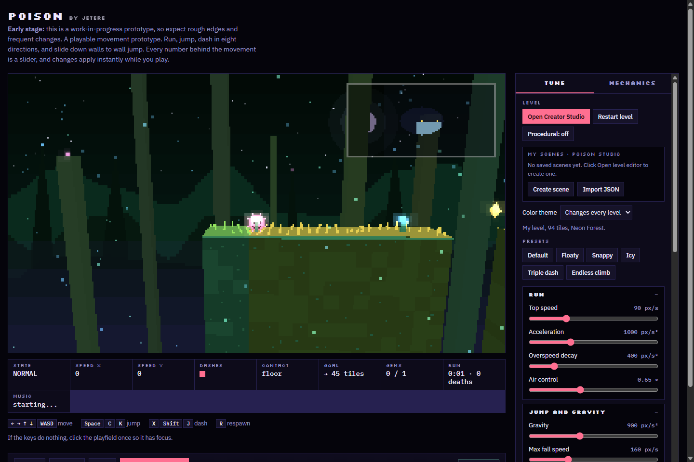
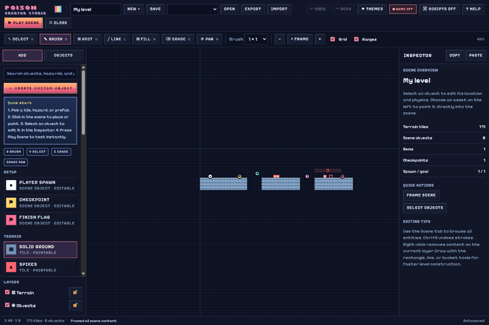

# Poison and Poison Studio

A pixel-art platformer and level editor by **Jetere**, built for Windows with Electron and Vite.

Play levels, adjust movement settings, and build your own scenes in Poison Studio. The software is in active development, so features and visuals may change.

## Screenshots

### Game



### Poison Studio



## Features

- Run, jump, dash in eight directions, and wall jump.
- Adjust movement and physics settings while playing.
- Build levels with terrain, hazards, moving platforms, and collectibles.
- Edit scenes with drawing tools, object properties, and undo/redo.
- Create custom objects and reusable prefabs.
- Design sky themes with moons, sunlight, galaxies, and mountain backgrounds.
- Generate procedural levels.
- Save scenes locally or import and export them as JSON files.
- Add custom object scripts with explicit permission before they run.

The game and its audio stop while Poison Studio is open. Use **Play scene** to test your work.

## Download and play

If a Windows build is available, download it from [Releases](https://github.com/jetere/poison/releases).

- **Installer:** installs the app and creates shortcuts.
- **Portable:** runs without installation.

These builds include the runtime. Players do not need Node.js.

## Run from source

You need **Windows 10 or 11 (64-bit)** and **Node.js LTS with npm**.

Clone the repository and install the dependencies:

```powershell
git clone https://github.com/jetere/poison.git
cd poison
npm install
npm run dev
```

This opens the desktop app. You can also double-click `RUN_POISON_WINDOWS.bat` after installing Node.js.

Other commands:

| Command | Purpose |
| --- | --- |
| `npm run dev:web` | Run the app in a browser using the local Vite server |
| `npm start` | Build and open the desktop app |
| `npm run check` | Check TypeScript and JavaScript syntax |
| `npm run build` | Check and build the frontend |
| `npm run test:smoke` | Build and test the main game and editor features |

Open the app through these commands. The root `index.html` requires Vite and cannot run directly from File Explorer.

If PowerShell blocks npm, use `npm.cmd` in place of `npm`.

## Controls

Click the game area to focus it before using the keyboard.

| Action | Keys |
| --- | --- |
| Move | Arrow keys or WASD |
| Jump | Space, C, or K |
| Dash | X, Shift, or J |
| Respawn | R |

Select **Open Poison Studio** to edit a level, then select **Play scene** to test it.

## Save and share scenes

Use the desktop **File** menu to open or save a scene as a JSON file. **Save Scene As** lets you choose a new file name or location.

Poison Studio also has a local scene library and JSON import/export buttons. Scene files preserve custom objects, prefabs, and custom theme data. Imported scripts stay disabled until you approve them in Studio.

## Build Windows executables

Run this on Windows:

```powershell
npm run dist:win
```

Or double-click `BUILD_WINDOWS_EXE.bat`.

The installer and portable executable are created in `release/`. To build just one:

```powershell
npm run dist:win:installer
npm run dist:win:portable
```

Builds are currently unsigned. The `release/` folder is excluded from Git; attach executables to a GitHub Release to share them.

## Source structure

| Path | Contents |
| --- | --- |
| `index.html` | Main page markup |
| `src/game/parts/` | Ordered game and editor source fragments |
| `src/styles/` | Game, editor, and desktop styles |
| `src/assets/` | Source assets, including audio |
| `src/desktop/` | Desktop file menu integration |
| `electron/` | Electron window, preload, and file handling |
| `scripts/` | Source assembly and test scripts |
| `docs/screenshots/` | Screenshots used in this README |
| `reference/` | Original single-file HTML backup |

The game started as a single HTML file. Its JavaScript is now split into ordered fragments that share one scope. `npm run assemble` combines them and embeds the audio for offline playback.

Edit files in `src/game/parts/`. Do not edit `src/generated/poison-runtime.js` directly; it is rebuilt automatically.

Electron uses context isolation and sandboxing, with Node.js disabled in the renderer. The game works offline with fallback fonts; Google Fonts require an internet connection.

## License

See [LICENSE](LICENSE) for the license terms.
